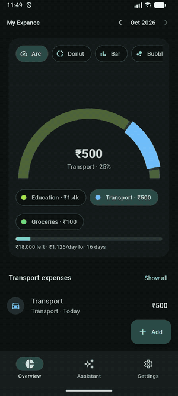
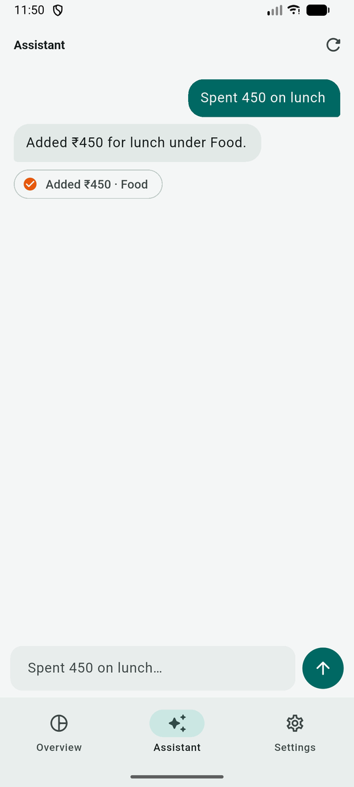
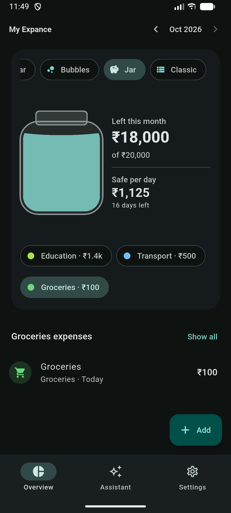
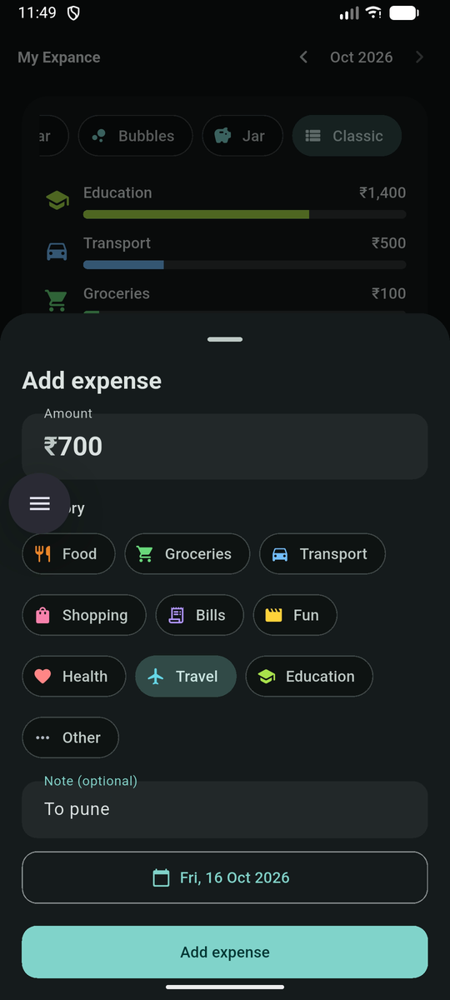
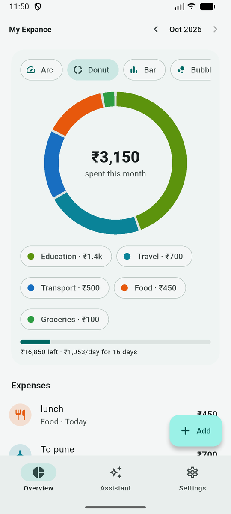
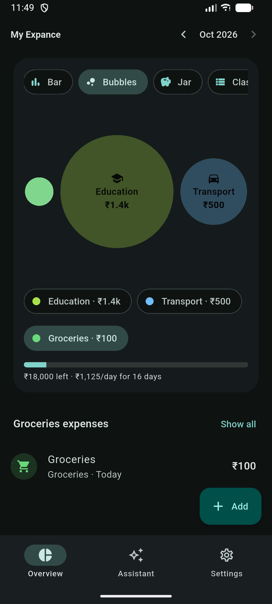
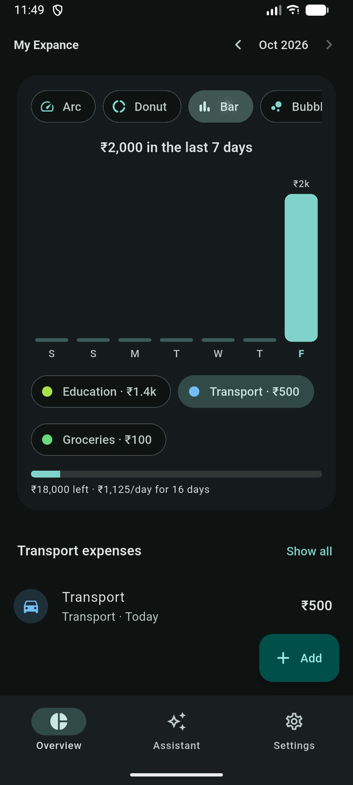
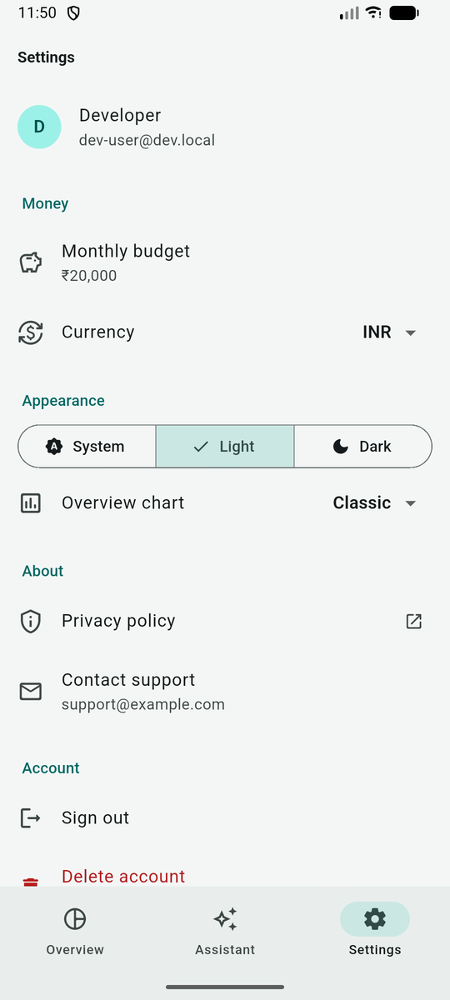

<p align="center"></p>

<p align="center">


</p>

**My Expance** is a full-stack expense tracker with an AI assistant. Type *"spent 450 on lunch"* or *"uber 220 yesterday"* and the agent logs it in the right category. Ask *"how much on food this month?"* and it answers from your real data. Built with a Flutter mobile app, a Flask API and a tool-calling LLM agent.

<p align="center"></p>

## Screenshots

| Talk to log | Six chart styles | Budget jar | Add expense |
|---|---|---|---|
|  |  |  |  |
| **Donut (light)** | **Bubbles** | **Last 7 days** | **Settings** |
|  |  |  |  |

## Features
- **Talk to log.** An LLM agent turns plain sentences into expenses, edits or deletes them, and answers spending questions. Every number it states comes from a tool call, never from the model's imagination.
- **Six ways to see the month.** Arc, Donut, Bar (last 7 days), Bubbles, Jar (budget left) and Classic, all hand-drawn with `CustomPaint`. The app remembers your pick; tap a colour to filter.
- **Budget jar.** What's left this month and a safe amount to spend per day.
- **Polished UI.** Material 3, light and dark themes, motion that respects "reduce motion", 48 px touch targets, screen-reader labels.
- **Production basics.** Firebase sign-in (Google, Apple, email), per-user data isolation, rate limits, a daily AI quota, crash reporting, account deletion and a hosted privacy policy.
- **Model-agnostic AI.** Works with Gemini, Groq, local Ollama or Anthropic Claude by changing one setting.

## Tech stack
| Layer | Technology |
|---|---|
| Mobile | Flutter (Dart), Provider, Material 3, CustomPaint charts, Firebase Auth & Crashlytics |
| API | Python, Flask, SQLAlchemy 2, Alembic, Flask-Limiter, gunicorn, Docker |
| AI | Tool-calling agent loop over OpenAI-compatible APIs (Gemini, Groq, Ollama) and Anthropic Claude |
| Data | PostgreSQL in production, SQLite locally |
| Quality | pytest (13 tests), Flutter unit tests, ruff, GitHub Actions CI |
| Hosting | Render blueprint (`render.yaml`): API + Postgres |

## Architecture
```
 Flutter app (iOS / Android)                       Render
 ┌───────────────────────────┐  HTTPS + Firebase  ┌──────────────────────────────┐
 │ Overview · Assistant       │  ID token          │ Flask API (gunicorn)         │
 │ Settings · Sign-in         │ ─────────────────▶ │  auth → verify Firebase JWT  │
 │ ExpenseStore (state)       │                    │  /api/expenses, /api/me      │
 │ 6 chart views (CustomPaint)│ ◀───────────────── │  /api/chat ─▶ agent loop ────┼──▶ LLM (tool use)
 └───────────────────────────┘  JSON              │        tools: add/update/    │
        │ Firebase Auth, Crashlytics               │        list/summary/budget   │
        ▼                                          │  SQLAlchemy ─▶ Postgres      │
   Google · Apple · Email                          └──────────────────────────────┘
```

**How the agent works:** the API sends the conversation plus tool schemas to the model. When the model asks for a tool (`add_expense`, `update_expense`, `list_expenses`, `spending_summary`, `budget_status`, `delete_expense`, `get_today`), the server runs it **as the signed-in user** (no tool accepts a user id), returns the result, and loops until the model replies. Rate-limit and overload errors from free tiers are retried automatically. The app shows a chip for every expense the agent logged.

## Folders
| Folder | What |
|---|---|
| `backend/` | Flask API: `app/` (routes, auth, agent, tools, services, models), Alembic migrations, tests, Dockerfile |
| `flutter/` | Flutter app: `lib/theme`, `lib/state`, `lib/logic` (pure, tested maths), `lib/widgets/charts`, `lib/screens` |
| `docs/` | Release guide, store listing kit, case study, media |
| `render.yaml` | One-click Render deploy (API + Postgres) |

## Run it locally (no Firebase needed)

**1. API**
```bash
cd backend
python3 -m venv .venv && source .venv/bin/activate
pip install -r requirements-dev.txt
cp .env.example .env          # add a free Gemini or Groq key; AUTH_MODE=dev is preset
python wsgi.py                # http://localhost:5001
pytest                        # 13 tests, no API key needed
```

**2. App**
```bash
cd flutter
flutter pub get
flutter test
flutter run --dart-define=DEV_AUTH=true      # tap "Continue as developer"
```
The Android emulator reaches your laptop at `10.0.2.2:5001` and the iOS simulator at `localhost:5001`. On a real phone, add `--dart-define=API_BASE_URL=http://<your-laptop-ip>:5001`.

## Choosing the AI model
Set `LLM_PROVIDER` (and optionally `LLM_MODEL`) in `backend/.env`:

| Provider | Cost | Key | Notes |
|---|---|---|---|
| `gemini` | Free tier | `GEMINI_API_KEY` from aistudio.google.com/apikey | e.g. `LLM_MODEL=gemini-3.8-flash` |
| `groq` | Free tier, no card | `GROQ_API_KEY` from console.groq.com/keys | Enable models under Project → Limits |
| `ollama` | Free, runs locally | none | `ollama pull qwen3:8b` |
| `anthropic` | Paid (Claude) | `ANTHROPIC_API_KEY` | `ANTHROPIC_MODEL=claude-haiku-5-5` |

## API
All `/api/*` routes need `Authorization: Bearer <Firebase ID token>` (in dev mode, any string, used as the user id).

| Method | Path | Purpose |
|---|---|---|
| GET | `/health` | Liveness + database check |
| GET · PATCH · DELETE | `/api/me` | Profile and budget · update budget/currency · delete account and all data |
| GET · POST | `/api/expenses` | List (`start`, `end`, `category`, `limit`) · add |
| PATCH · DELETE | `/api/expenses/<id>` | Edit · delete |
| GET | `/api/summary` | Totals by category + budget status |
| POST | `/api/chat` | `{messages:[{role,content}]}` → `{reply, actions}` |
| GET | `/privacy`, `/account-deletion` | Public pages the app stores require |

## Quality
- **Backend:** 13 pytest tests: CRUD, validation, user isolation, account deletion, Firebase token check, the agent loop with fake Claude and fake OpenAI-compatible models, retry on overload, and the daily quota. Plus ruff lint and migrations tested up and down.
- **Flutter:** unit tests for category grouping (top 5 + Other), the 7-day series, budget maths, bubble packing (no overlaps, stays in bounds) and ₹ formatting.
- **CI:** GitHub Actions runs both on every push.

## Ship it
[`docs/RELEASE.md`](docs/RELEASE.md) covers Firebase, Render, Play Store and App Store. [`docs/STORE_LISTING.md`](docs/STORE_LISTING.md) has listing copy and privacy answers. [`docs/CASE_STUDY.md`](docs/CASE_STUDY.md) explains the design decisions.

## Licence
MIT
