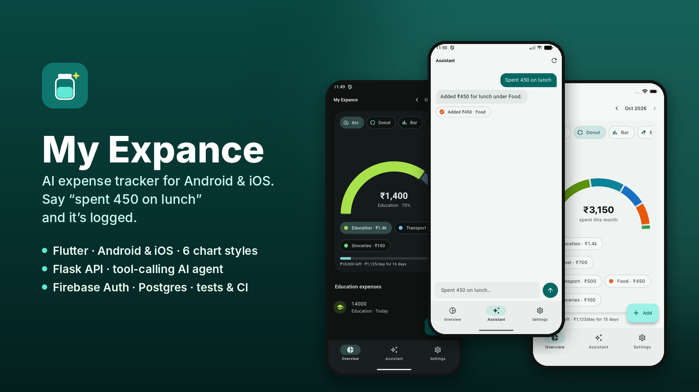
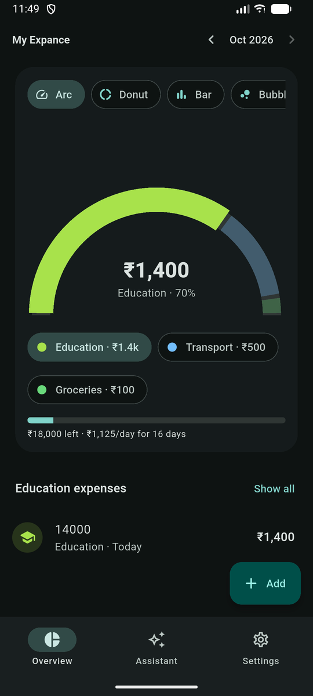
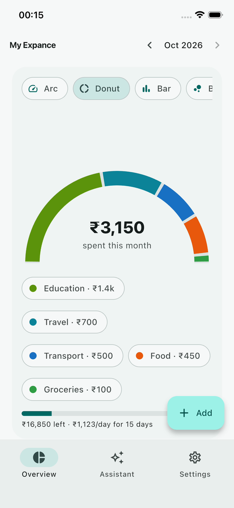

# Case study: My Expance

**An AI expense tracker for Android and iOS: Flutter app, Flask API and a tool-calling LLM agent.**



## The problem
Most expense apps lose users at the same step: data entry. Opening a form, choosing a category, typing an amount and picking a date takes long enough that people stop logging after a week. The goal was an app where logging takes one sentence, and where the overview tells you at a glance whether you're on track.

## The solution
- **Talk to log.** The user types *"uber 220 yesterday"*. An LLM agent calls `add_expense` with the amount, the category (transport) and yesterday's date, and the app shows a confirmation chip. The same assistant edits, deletes and answers questions like *"how much on food this month?"*.
- **Six views of the same month.** Different people read money differently, so the overview offers Arc, Donut, Bar, Bubbles, Jar and Classic views, hand-drawn with Flutter's `CustomPaint`. Tapping a colour filters the expense list.
- **A budget jar.** It shows what's left this month and a safe amount to spend per day for the remaining days.

## Key engineering decisions

**1. The model never touches the database directly.** The agent can only call seven narrow tools (`add_expense`, `update_expense`, `delete_expense`, `list_expenses`, `spending_summary`, `budget_status`, `get_today`). The server runs each tool as the signed-in user, and no tool accepts a user id, so a prompt-injection attempt can't reach anyone else's data. Tool inputs go through the same validation as the REST API.

**2. Numbers come from tools, not the model.** The system prompt requires every figure in a reply to come from a tool result. Totals and budget maths are computed in SQL and Python, and the model only phrases the answer.

**3. Model-agnostic by design.** The agent loop supports any OpenAI-compatible API (Gemini, Groq, local Ollama) as well as Anthropic Claude. Switching providers is one environment variable, which kept development free and lets a client choose cost against quality later. Free-tier rate limits and "model overloaded" errors are retried with backoff and shown to the user as a friendly "busy" message.

**4. Logic that can be tested is kept pure.** Category grouping (top 5 + Other), the 7-day series, budget maths, ₹ formatting with Indian digit grouping and the bubble-packing layout are plain Dart functions with unit tests. The bubble packer was fuzz-tested on thousands of random inputs to confirm circles never overlap and always stay inside the chart.

**5. Store-ready from day one.** Firebase Auth (Google, Apple, email), per-user rate limits and a daily AI quota, account deletion that removes all data, hosted privacy and account-deletion pages, and crash reporting are all built in. These are the items Google Play and the App Store review.

## Cross-platform
One Flutter codebase runs on both Android and iOS with the same features, themes and AI assistant. Both were recorded running against the same Flask backend.

| Android | iOS |
|---|---|
|  |  |

## Architecture
```
Flutter app ──HTTPS + Firebase ID token──▶ Flask API ──▶ PostgreSQL
                                             │
                                             └─ /api/chat ─▶ agent loop ⇄ LLM (tool calls)
```

## Quality
- 13 backend tests (pytest): CRUD, validation, user isolation, account deletion, token verification, the agent loop against fake models, retry behaviour and the daily quota.
- Flutter unit tests for all chart and budget maths.
- ruff lint, Alembic migrations tested up and down, and GitHub Actions CI on every push.

## Stack
Flutter · Dart · Provider · CustomPaint · Firebase Auth & Crashlytics · Python · Flask · SQLAlchemy · Alembic · PostgreSQL · Docker · Render · Gemini / Groq / Claude
